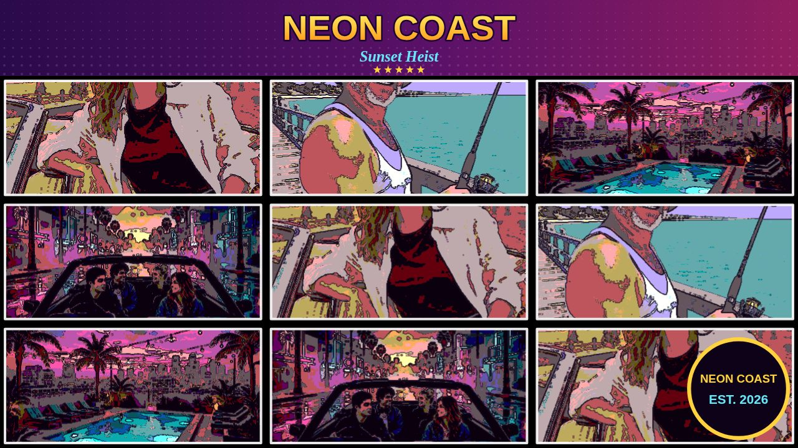
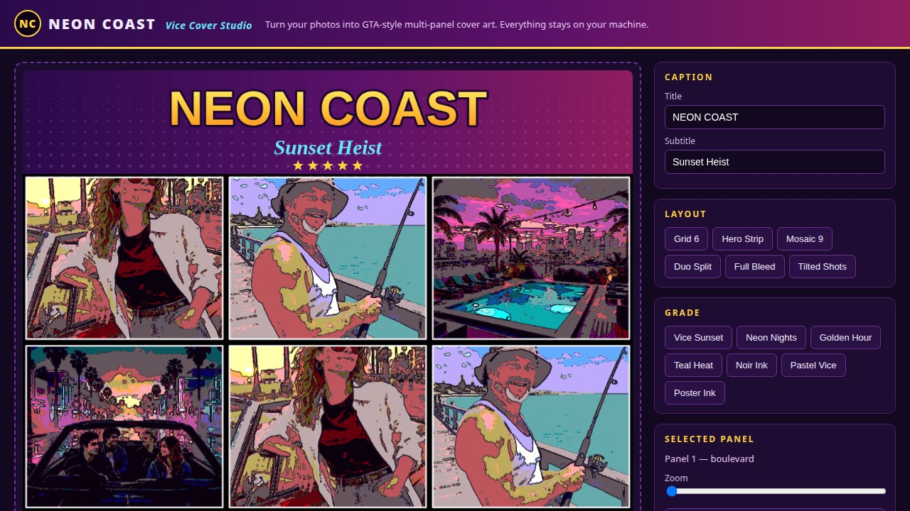
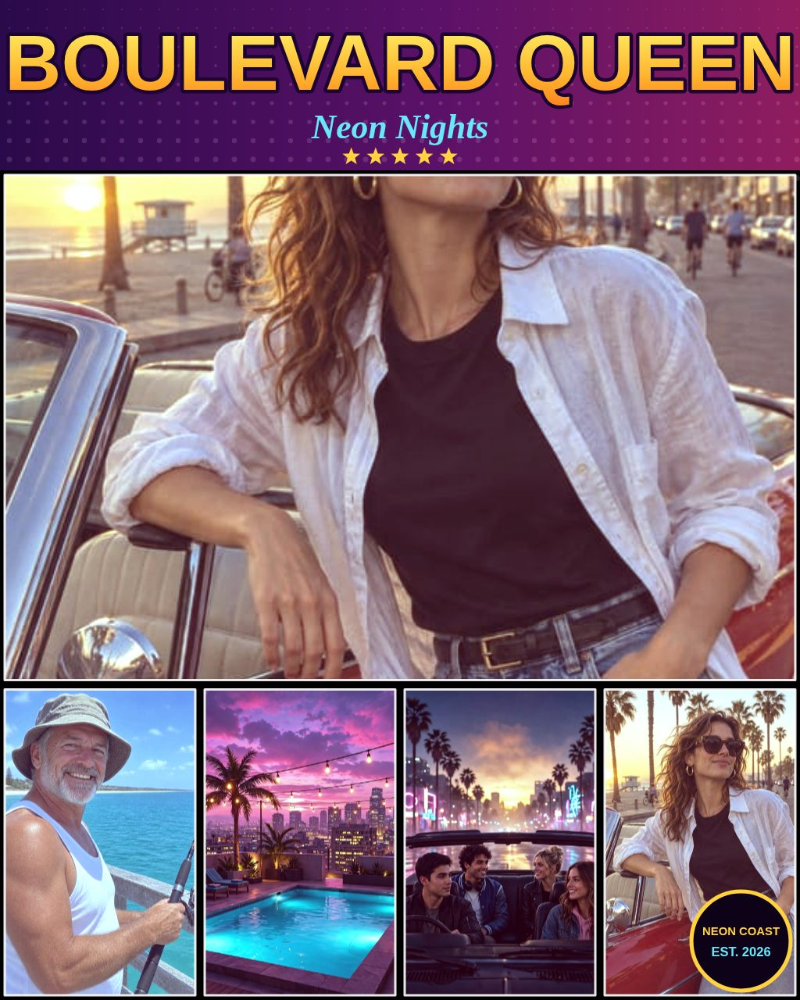
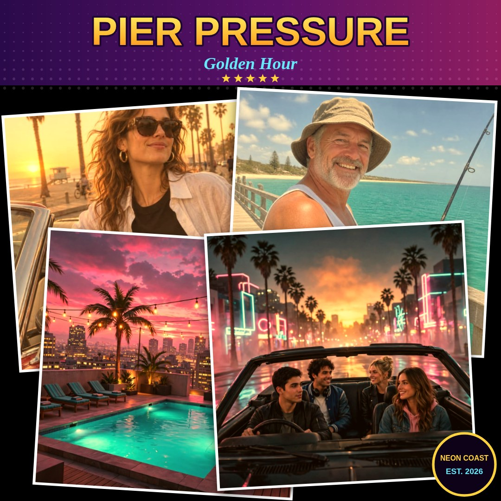

# NEON COAST — Vice Cover Studio

[](https://make.fun/bounty/gta6-cover-art-01)
[](https://make.fun/bounty/gta6-cover-art-01)
[](https://make.fun/bounty/gta6-cover-art-01)

An offline web app that turns your photos into GTA-style multi-panel cover art
and exports it as a PNG. Pick a layout, pick a grade, drag each photo into
place, write your title, export.

## What it does

- **6 layouts** — Grid 6, Hero Strip, Mosaic 9, Duo Split, Full Bleed, Tilted Shots.
- **7 grades** — Vice Sunset, Neon Nights, Golden Hour, Teal Heat, Noir Ink,
  Pastel Vice, and the flagship **Poster Ink**: each photo is posterized to
  flat tones, then a Sobel edge detector draws dark ink edges over it.
- **4-photo sample library** — Boulevard and Pier from the kit starter, plus a
  rooftop pool party and friends in a convertible, both generated for this entry.
- **Editor** — multi-upload and drag-drop (photos never leave your machine),
  click a panel to select it, per-panel photo choice, zoom slider, drag to
  reposition, undo/redo, shuffle, spread one photo across all panels, editable
  title and subtitle.
- **Export** — PNG in 1080×1080, 1080×1350, 1080×1920 and 1920×1080, or all
  four at once.
- **The look** — a halftone title band in deep purple and magenta, a big
  yellow-to-orange gradient title with a dark outline, a cyan script subtitle,
  five gold stars, and a round black-and-gold "NEON COAST / EST. 2026" badge.

## Run it

Serve `app/` with any static server and open `index.html` — no build step, no
network requests, everything it loads is a file under `app/`.

```sh
node serve.ts        # or: python3 -m http.server --directory app 8080
```

Screenshot scenes are staged with `?shot=` (`cover`, `editor`, `portrait`,
`square`); see `shots.json` for the four scenes used below.

## Screenshots






## Hand in

```sh
MAKEFUN_OUTPUT_DIR=out node main.ts
```

`main.ts` copies `app/` and `screenshots/` to the output directory and writes
`dossier.json` with the vendored make.fun library.
